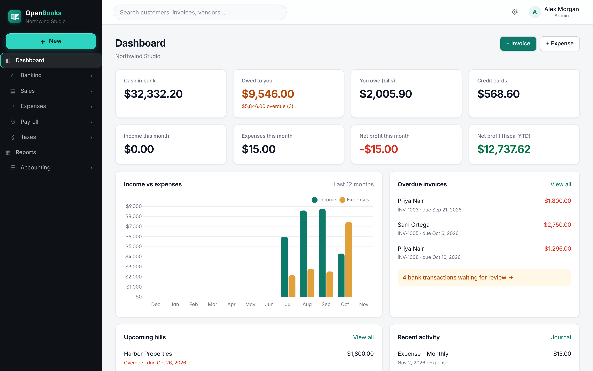

<p align="center"></p>

# OpenBooks

<picture>
  <source media="(prefers-color-scheme: dark)" srcset="docs/dashboard-dark.png">
  
</picture>

Self-hosted double-entry accounting for small businesses: invoices, bills, expenses, bank imports,
chart of accounts, journal entries and financial reports, in one Docker container.

## Quick start (Docker)

From this folder (the one containing `docker-compose.yml`):

```bash
docker compose up -d --build
```

Open <http://localhost:3000> (or `http://<server-ip>:3000` from another machine) and sign in with:

- **Email:** `admin@openbooks.local`
- **Password:** `openbooks`

On that first sign-in you're asked to create your own administrator account (name, email and a password of
at least 10 characters). The default `admin@openbooks.local` login is then **deleted** and can't be used again.
If you'd rather start with your own credentials, set `ADMIN_EMAIL` / `ADMIN_PASSWORD` in `docker-compose.yml`
*before* the first start (a non-default password skips this step). Existing installs where an admin still uses
the default password get the same prompt on their next sign-in. On an empty
company the dashboard offers a **Load sample data** button so you can explore with realistic data.

Data is stored in SQLite inside the `openbooks-data` Docker volume, so it survives restarts and upgrades.

### Common commands

| Task | Command |
| --- | --- |
| Start / rebuild after pulling changes | `docker compose up -d --build` |
| View logs | `docker compose logs -f` |
| Stop | `docker compose down` |
| Back up the database | `docker compose cp openbooks:/data/openbooks.db ./openbooks-backup.db` |
| Erase everything and start over | `docker compose down -v` |

### Configuration (environment variables)

| Variable | Default | Purpose |
| --- | --- | --- |
| `PORT` | `3000` | Port the server listens on inside the container |
| `ADMIN_EMAIL` / `ADMIN_PASSWORD` | `admin@openbooks.local` / `openbooks` | First admin account (only used when the database is new) |
| `DEMO_DATA` | `false` | `true` fills a brand-new database with sample data |
| `SECRET_KEY` | generated, saved in `/data/secret_key` | Signs login sessions |
| `SESSION_COOKIE_SECURE` | `false` | Set `true` when served over HTTPS |
| `DATA_DIR` | `/data` | Where the database and secret key live |
| `DATABASE_URL` | `sqlite:////data/openbooks.db` | SQLAlchemy URL if you want a different database |
| `PUBLIC_URL` | address in the browser | Base URL used in customer "pay online" links and Stripe redirects |
| `STRIPE_SECRET_KEY`, `STRIPE_PUBLISHABLE_KEY`, `STRIPE_WEBHOOK_SECRET` | *(none)* | Optional: your own Stripe account (or enter them in Settings) |
| `ANTHROPIC_API_KEY` | *(none)* | Optional: your own Anthropic key for the AI assistant (or enter it in Settings) |
| `PLAID_CLIENT_ID`, `PLAID_SECRET`, `PLAID_ENV` | *(none)*, `sandbox` | Optional: your own Plaid keys for bank feeds (or enter them in Settings) |
| `GOCARDLESS_SECRET_ID`, `GOCARDLESS_SECRET_KEY` | *(none)* | Optional: your own GoCardless Bank Account Data keys for bank feeds |
| `BANK_SYNC_DISABLED` | `false` | `true` turns off the background bank sync (Sync now still works) |

If you bind-mount a host folder instead of the named volume, make it writable by UID 1000
(`sudo chown 1000:1000 ./data`).

## Choosing how taxes are calculated

**Settings → Tax calculation** sets the method for the whole company. The settings shown change with the choice:

- **A) Manually entered:** you enter your own sales tax rates and codes, and fixed withholding percentages for each
  employee.
- **B) US tax tables (unverified):** payroll withholding comes from the built-in federal tables and each employee's
  W-4, with a reminder of how many tables still need verifying. Sales tax still uses your own rates and codes.
- **C) Third-party tax service:** Stripe Tax calculates sales tax from customer addresses (requires Stripe to be
  connected). Because Stripe doesn't do payroll, you choose fixed percentages or the US tables for payroll.

New employees follow the chosen method, and you can switch existing employees in the same step.

## Sample data and starting over

The dashboard's **Load sample data** button records exactly what it creates. While sample data is loaded, the
dashboard shows a banner with **Remove sample data**, which deletes only those records (also under
**Settings → Data**). If you've added your own records since loading it, removal is refused so nothing of yours is
lost; use **Erase all data** instead. That deletes every transaction, customer, vendor, product and employee
(type ERASE to confirm), and keeps users, settings, the chart of accounts and payroll tax tables.

## Sales tax, VAT and GST

**Taxes → Sales tax** handles US-style sales tax as well as VAT/GST:

- **Agencies** are the authorities you pay (a state revenue department, a city, HMRC, CRA, ATO…), each with a filing
  frequency. **Rates** belong to an agency. **Tax codes** combine one or more rates (e.g. state 6.5% + county 0.5% +
  city 3.35%) and are what you pick on each invoice, receipt, estimate, bill or expense line.
- Products, customers and the company each have a default code; customers can be marked tax-exempt with a reason.
- Prices can be entered **exclusive or inclusive** of tax. Tax is rounded once per rate on the document total, and
  tax-inclusive amounts are split exactly between component rates.
- Rates marked "sales and purchases" also apply to bills and expenses as **reclaimable input tax** (VAT/GST), which
  reduces what you owe. US users simply don't put tax codes on purchases.
- Each saved document keeps a snapshot of its tax, so changing a rate later never rewrites history.
- The **Overview** shows each agency's balance and filing periods (monthly / quarterly / annual) with tax collected,
  tax on purchases, net due and status; **Record payment** posts the payment (or refund) to Sales Tax Payable.
  The **Liability report** breaks it down by agency and rate, with taxable, non-taxable and exempt sales.
- Quick-start templates add the standard national rates for the UK, Canada, Australia and New Zealand. Check them
  against your registration. For US state and local rates, enter the rates for where you are registered.
- **Automatic rates (optional):** with Stripe connected, choose *Stripe Tax* in the tax settings and OpenBooks asks
  Stripe Tax for the correct rates from each customer's address (country and postal code at minimum). Jurisdictions
  returned by Stripe become agencies automatically. Requires Stripe Tax to be set up, with your registrations, in
  the Stripe Dashboard; Stripe charges per calculation, so OpenBooks only calculates on save or when you click
  *Calculate tax*.

Invoices saved with the earlier single flat tax rate are upgraded automatically: a "Sales tax" agency, rate and
code are created to match, totals stay the same, and their tax appears in the liability report.

## Payroll tax

**Taxes → Payroll tax** holds the tax tables used to calculate paychecks. Each table is data for one tax year and
jurisdiction, which you can edit:

- **Federal income tax withholding** follows the IRS percentage method for Forms W-4 from 2020 on
  (Publication 15-T). Each employee's W-4 details are entered on their profile: filing status, the Step 2
  multiple-jobs box, dependents credit, other income, deductions and extra withholding.
- **Social security** (with the annual wage base), **Medicare** and **additional Medicare** (0.9% over $200,000),
  **FUTA**, and per-state **SUTA** (enter your employer rate and wage base).
- **State income tax** tables can be *no income tax*, a *flat rate*, or *brackets*. Built-in tables are included
  only for states with no income tax on wages; add a table for any other state you have employees in.
- Built-in federal figures for 2025 and 2026 are a **starting point and are marked unverified**. An administrator
  should check each table against the official source for the year, correct anything that differs, and mark it
  verified (who verified it, and when, is recorded). Editing a table clears its verification. Running payroll with
  unverified tables requires an explicit acknowledgement. **Copy to next year** starts a new year from the previous
  one's tables.
- The **Liability report** totals tax withheld and employer tax by type for a date range.
- Employees can instead use fixed percentages you enter (the original method). Existing employees keep that
  method until you switch them.

OpenBooks calculates withholding but does not file returns or make tax deposits. You remain responsible for
using current, correct tables. Pre-tax deductions (such as 401(k) or Section 125 plans) are not modelled yet.

## Income tax preparation

**Taxes → Income tax** groups the year's income and expenses the way a business tax return asks for them:

- Choose the return the business files: **Schedule C** (sole proprietor), **Form 1120** (C corporation),
  **Form 1120-S** (S corporation), **Form 1065** (partnership), or **custom categories** for any other country.
- **Account mapping** assigns each income and expense account to a return line. *Auto-map* suggests lines from
  each account's type and name (advertising, rent, meals, wages, payroll taxes and so on), and you can change any.
  Mappings are kept separately for each return type.
- The **Tax summary** totals each line for the tax year (following the fiscal year start in Settings), lets you
  drill into the accounts behind a line, warns about unmapped accounts, flags items such as meals that are generally
  only 50% deductible, and exports to CSV or prints for your tax preparer. Net profit matches the Profit & Loss
  report for the same period.

It is a preparation aid built from your books. It does not calculate the tax owed, handle book-to-tax differences
(such as tax depreciation) or file anything. Confirm line numbers against the current year's forms.

## Online payments with Stripe (optional)

Each OpenBooks instance connects **its own** Stripe account; nothing is hard-coded.

1. In the Stripe Dashboard, copy your API keys from **Developers → API keys** (start with test keys).
2. In OpenBooks go to **Settings → Online payments**, paste the publishable and secret keys, choose the bank
   account Stripe pays out to, and set the public URL if OpenBooks is behind a proxy or domain.
3. In Stripe, **Developers → Webhooks → Add endpoint**: use the webhook URL shown in Settings
   (`https://your-host/api/stripe/webhook`), select `checkout.session.completed` and
   `checkout.session.async_payment_succeeded`, then paste the signing secret back into OpenBooks.
4. Turn online payments on. Open any unpaid invoice and click **Share payment link**.

Customers open the link (no login needed), pay by card on Stripe Checkout, and the payment is recorded on the
invoice automatically. Secret keys are stored on your server and never sent back to the browser; you can supply them
with environment variables instead. The webhook verifies Stripe's signature, and repeat deliveries are ignored.
Stripe fees are not recorded automatically. Record them as a bank fee expense when Stripe pays out.

## Bank feeds (optional)

OpenBooks can pull transactions straight from your bank into **Banking → For review**, so you no longer need to
download CSV statements. Nothing is hard-coded: each host uses its own provider account, and you can use more
than one provider at once.

| Provider | Countries | What the host sets up |
| --- | --- | --- |
| **SimpleFIN Bridge** | United States | Nothing. Each user subscribes to SimpleFIN (a small yearly fee, paid to SimpleFIN), connects their bank there and pastes a one-time setup token. |
| **Plaid** | US, Canada, UK, much of Europe | A Plaid app with the Transactions product. Enter the client ID, secret and environment in **Settings → Bank connections**. Sandbox works with Plaid's test banks; production needs Plaid's approval and is billed by Plaid. |
| **GoCardless Bank Account Data** | UK and the EEA (open banking) | A secret ID and key from the GoCardless Bank Account Data portal. Check that GoCardless is still accepting new sign-ups in your region. |

To connect a bank, an administrator clicks **Banking → Connect bank**, picks a provider and signs in to the bank
through it. GoCardless sends you to the bank's own website and back to `/banking/connect/callback`, so set
`PUBLIC_URL` if OpenBooks sits behind a proxy. Then choose which OpenBooks bank or credit card account each bank
account imports into, and the date to import from.

- New transactions are fetched every 6 hours by default (change it in Settings, or `0` to turn it off).
  **Sync banks** and **Sync now** fetch them immediately.
- Each transaction keeps the provider's ID, so syncing again never creates duplicates. Pending transactions are
  skipped until they post. If Plaid corrects or removes a transaction you have not categorised yet, OpenBooks
  updates or removes it too.
- Access is read-only. Bank access tokens and provider secrets are encrypted at rest with a key derived from
  `SECRET_KEY` and are never sent to the browser. If `SECRET_KEY` changes, reconnect your banks.
- **Disconnect** stops syncing and, for Plaid, revokes access. Transactions already imported stay in OpenBooks.

## AI assistant with Claude (optional)

**Settings → AI assistant** lets an administrator connect their own Anthropic API key (from console.anthropic.com),
pick a model (Claude Opus 5.5 by default, or Sonnet 5.5 / Haiku 5.5) and turn it on. Everyone then gets an
**Ask Claude** button that answers questions like "Who owes me the most?" from the live books. The assistant is
read-only: its tools call the same report and list endpoints as the UI, with the signed-in user's permissions,
and it cannot create, change or delete anything. Questions and the figures needed to answer them are sent to
Anthropic; usage is billed to your Anthropic account.

## Features

- **Navigation** – a **+ New** menu for every transaction type, grouped sidebar (Banking, Sales, Expenses, Payroll,
  Reports, Accounting), global search, and a settings gear menu
- **Dashboard** – cash, receivables, payables, monthly and year-to-date profit, 12-month income vs. expense chart,
  overdue invoices, upcoming bills
- **Sales** – invoices, estimates (convert to invoice), sales receipts, receive one payment across several invoices,
  products & services that fill in invoice lines, billable time pulled onto invoices, printable/PDF documents,
  summary bar of open estimates / overdue / open / paid
- **Expenses** – expenses, checks, bills, and a Pay bills screen to pay several bills at once
- **Banking** – automatic bank feeds (SimpleFIN, Plaid or GoCardless; see above) or bank/credit-card CSV statements, categorise or exclude each line, bank deposits, transfers
  between accounts, and a guided **Reconcile** screen that counts the difference down to 0.00
- **Payroll** – employees, weekly timesheets, run payroll with a live paycheck preview, pay stubs, payroll tax
  payments, and withholding calculated from W-4 details and editable tax tables (see Payroll tax above)
- **Accounting** – editable chart of accounts, manual journal entries with balance checking
- **Reports** – Profit & Loss, Balance Sheet, Trial Balance, General Ledger, A/R and A/P aging; print or export to CSV
- **Sales tax / VAT / GST** – agencies, combined rates, per-line tax codes, inclusive pricing, exemptions, liability report, tax payments, optional Stripe Tax (see above)
- **Income tax prep** – map accounts to Schedule C / 1120 / 1120-S / 1065 lines (or your own categories) and print a year-end summary
- **Online payments** – optional Stripe "pay this invoice" links (see above)
- **AI assistant** – optional, read-only Claude assistant (see above)
- **Users** – administrator, accountant and read-only viewer roles
- **Appearance** – light, dark or follow-system theme (account menu)

Every transaction posts a balanced journal entry, so all reports come from one general ledger.
Amounts are stored as integer cents to avoid rounding errors.

## Project layout

```
backend/            Flask API (Python 3.11+)
  openbooks/        models, ledger posting, API routes, seed data
  tests/            pytest suite
  wsgi.py           gunicorn entry point
frontend/           React + Vite web UI
Dockerfile          builds the UI, then serves it and the API from one container
docker-compose.yml
```

## Development

Backend (serves the API on port 5000):

```bash
cd backend
python -m venv .venv && . .venv/bin/activate
pip install -r requirements-dev.txt
pytest
flask --app wsgi run --port 5000 --debug
```

Frontend (hot-reloading dev server on port 5173, proxies `/api` to port 5000):

```bash
cd frontend
npm install
npm run dev
```

## Testing

Backend tests (82 of them, covering the ledger, every API area, taxes, payroll, Stripe, the assistant
and bank feeds):

```bash
cd backend
pytest
```

Browser tests: real clicks in Chromium against a throwaway Docker container, covering every page,
every create/edit flow, user roles, phone and ultrawide layouts, and bank feeds. See
[`e2e/README.md`](e2e/README.md) for details.

```bash
bash e2e/run.sh
```
